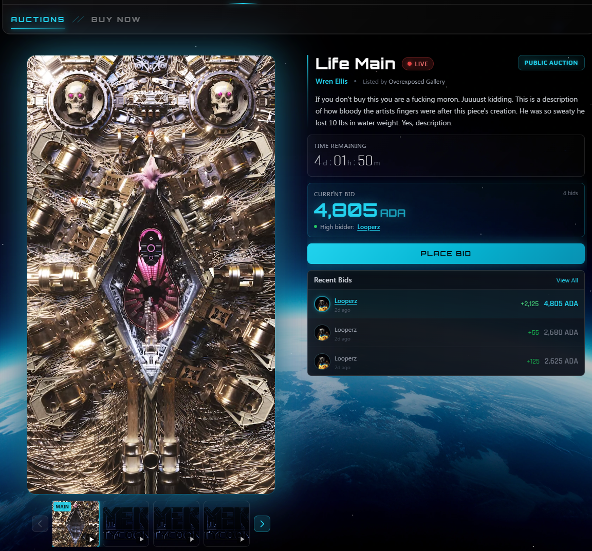
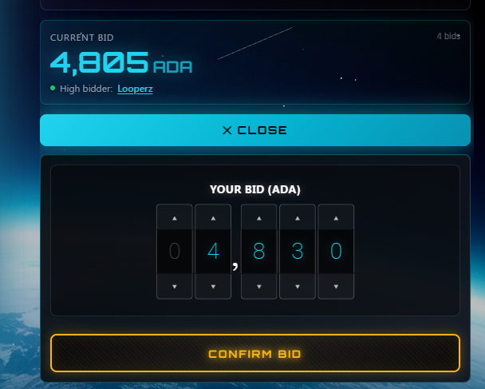

# Cardano Auctions

**Cardano NFT auctions with escrow-based bidding, automatic refunds, and on-chain settlement — fully self-contained WordPress plugin.**

A Pb Project | [cardanowordpressplugins.com](https://cardanowordpressplugins.com)

---

## What It Does

Cardano Auctions brings English-style NFT auctions to WordPress. Every bid is backed by real ADA in a unique escrow wallet. When a bidder is outbid, they're automatically refunded. When the timer expires, the NFT transfers to the winner and the ADA goes to the seller — all on-chain, all automatic.

### How It Works

```
Admin generates master wallet → Sends NFTs to master wallet → Creates auction (browse & select NFT)
                                                                        ↓
Bidder connects CIP-30 wallet → Places bid → ADA sent to HD-derived escrow wallet
                                                ↓
                             WP-Cron monitors Blockfrost for payment
                                                ↓
                         Payment confirmed → Bid locked in → Old bidder refunded
                                                ↓
                     Timer expires → NFT sent from master wallet → Winner
                                    ADA sent from escrow → Seller
```

### Key Features

- **Master HD wallet** — a single seed generates all escrow addresses via CIP-1852 HD derivation. One wallet to manage, deterministic child addresses for every bid.
- **NFT browser** — when creating an auction, browse NFTs directly from your master wallet and select one with a click. No need to manually paste asset IDs.
- **Escrow-based bidding** — each bid gets its own unique HD-derived wallet. No funds are commingled.
- **CIP-30 wallet connect** — works with Nami, Eternl, Lace, Flint, Vespr, Yoroi, and more.
- **Automatic refunds** — outbid? Your ADA is sent back automatically via a server-signed transaction.
- **Auto-settlement** — when the auction ends, the NFT transfers from the master wallet to the winner and ADA goes to the seller. No manual intervention.
- **Anti-snipe protection** — configurable timer extension when bids arrive near the deadline.
- **NFT custody** — the master wallet holds the NFTs being auctioned. At settlement, the NFT is sent directly to the winner. Legacy per-auction custody wallets are also supported as a fallback.
- **NFT minting** — create minting policies, upload images to IPFS via Pinata, build CIP-25 metadata, and mint NFTs directly to the master wallet. Auto-populates auction fields from minted NFTs.
- **Embeddable widget** — deploy auctions on any external site via a JavaScript widget. API key authentication with origin restrictions, CORS support, and theme customization. Managed from the Widget Deployer admin page.
- **Gallery images** — auctions support multiple images with a thumbnail strip and click-to-switch on the frontend.
- **Admin dashboard** — create auctions, monitor bids in real-time, view event logs, export CSV, manage the master wallet, send ADA, and browse on-chain assets.
- **NFT metadata display** — the frontend auction card includes a collapsible NFT Details section showing policy ID, asset name, and all on-chain metadata.
- **Shortcodes** — drop `[cardano_auction id="123"]` on any page to display a live auction.
- **Zero plugin dependencies** — all Cardano cryptography (Ed25519, BIP39, CIP-1852), blockchain API clients, CBOR codec, and wallet connect are embedded directly. No other plugins required.

---

## Requirements

| Requirement | Version |
|-------------|---------|
| WordPress | 5.9+ |
| PHP | 7.4+ |
| PHP Extensions | `sodium`, `openssl`, `bcmath`, `json` |
| Blockfrost API Key | [blockfrost.io](https://blockfrost.io) (free tier works) |
| Anvil API Key | [ada-anvil.io](https://ada-anvil.io) (for tx building) |
| Pinata API Key | [pinata.cloud](https://pinata.cloud) (optional — for NFT minting / IPFS uploads) |

---

## Installation

1. Upload the `cardano-auctions` folder to `/wp-content/plugins/`.
2. Activate the plugin through the **Plugins** menu in WordPress.
3. Go to **Cardano Auctions → Settings** and enter your API keys.
4. Create your first auction.

For production, set up a **system cron** to hit `wp-cron.php` every minute:

```bash
* * * * * curl -s https://yoursite.com/wp-cron.php?doing_wp_cron > /dev/null 2>&1
```

This ensures payment monitoring, refund processing, and auto-settlement run reliably instead of depending on site visitors to trigger WP-Cron.

---

## Quick Start

### 1. Configure API Keys

Go to **Cardano Auctions → Settings**:
- Select your network (Preprod for testing, Mainnet for production)
- Enter your Blockfrost API key (get one free at [blockfrost.io](https://blockfrost.io))
- Enter your Anvil API key (get one at [ada-anvil.io](https://ada-anvil.io))
- Set your default seller address
- Save

### 2. Generate a Master Wallet

Go to **Cardano Auctions → Wallets**:
- Click **Generate Master Wallet**
- **Write down the 24-word recovery phrase** — it is shown once and cannot be retrieved later
- Click "I've saved it — dismiss" to clear the mnemonic from screen
- The master wallet address is displayed — fund it with ADA and send NFTs you want to auction here

The master wallet is the single seed that HD-derives all escrow addresses. All bid escrow wallets are generated as child addresses from this seed using CIP-1852 derivation.

### 3. Create an Auction

Go to **Cardano Auctions → Create Auction**:
- Enter a title and description
- Click **Browse Master Wallet NFTs** to see all NFTs in your master wallet — click one to select it. Or paste the NFT unit manually and click **Lookup NFT**
- Set starting bid, reserve price, and end time
- Save

### 4. Verify & Activate

On the auction edit page, the right panel shows your master wallet address. Click **Check NFT in Master Wallet** to verify the NFT is there, then click **Activate Auction**.

> **Legacy mode**: Sites without a master wallet still work the old way — a separate custody wallet is generated per auction, and you send the NFT there manually.

### 5. Embed on a Page

Use the shortcode on any page or post:

```
[cardano_auction id="123"]
```

Or display a grid of all active auctions:

```
[cardano_auction_list status="active" limit="12"]
```

---

## Architecture

### Bid Flow

1. Bidder connects their CIP-30 wallet (Nami, Eternl, etc.)
2. Enters bid amount and clicks "Place Bid"
3. Backend HD-derives a unique escrow wallet from the master seed (CIP-1852, next available index)
4. Backend returns escrow address + payment deadline
5. Frontend builds a payment transaction via Anvil API
6. Bidder signs in their wallet popup
7. Transaction submitted to Cardano
8. WP-Cron polls Blockfrost every 30 seconds for payment
9. When payment arrives: bid confirmed, auction state updated
10. If outbid: automatic refund transaction built, signed server-side, and submitted

### Settlement Flow

1. Cron detects `end_time < now` for active auctions
2. Status set to `settling`
3. **NFT Transfer**: master wallet → winner's address (server-signed)
4. **ADA Transfer**: winning escrow → seller's address (server-signed)
5. Both tx hashes recorded, status set to `settled`
6. If no bids or reserve not met: NFT returned to seller from master wallet, auction cancelled

> Sites without a master wallet fall back to the legacy per-auction custody wallet model for NFT transfer.

### Security

- **Wallet key encryption**: AES-256-CBC with keys derived from WordPress authentication salts
- **Row-level locking**: `SELECT ... FOR UPDATE` prevents race conditions on concurrent bids
- **Rate limiting**: 5 bids per minute per IP via WordPress transients
- **Address validation**: Bech32 format regex validation
- **Input sanitization**: All REST inputs sanitized, all outputs escaped
- **Prepared statements**: All database queries use `$wpdb->prepare()`
- **Admin authorization**: Settings and auction management require `manage_options` capability + nonce verification

---

## Database Schema

The plugin creates 6 custom tables on activation:

| Table | Purpose |
|-------|---------|
| `{prefix}ca_auctions` | Auction details, NFT info, current bid state, settlement tx hashes |
| `{prefix}ca_bids` | Individual bids with escrow wallet reference, payment status, refund tracking |
| `{prefix}ca_escrow_wallets` | Encrypted wallet keys, addresses, balance cache, purpose (escrow/custody), master wallet linkage |
| `{prefix}ca_master_wallets` | Master HD wallet: encrypted mnemonic + signing key, address, derivation index, archive state |
| `{prefix}ca_mint_policies` | Minting policies for NFT creation (policy ID, expiration, status) |
| `{prefix}ca_event_log` | Audit trail of all auction events for monitoring and debugging |

All tables are created via `dbDelta()` for safe upgrades.

---

## REST API

| Method | Endpoint | Auth | Purpose |
|--------|----------|------|---------|
| `GET` | `/cah/v1/auctions` | Public | List active auctions |
| `GET` | `/cah/v1/auctions/{id}` | Public | Get auction details + current state |
| `GET` | `/cah/v1/auctions/{id}/bids` | Public | Bid history (addresses truncated) |
| `GET` | `/cah/v1/auctions/{id}/bidder-status` | Public | Check a wallet's status on an auction |
| `POST` | `/cah/v1/auctions/{id}/bid` | WP Nonce or API Key | Place bid → returns escrow address |
| `GET` | `/cah/v1/bids/{id}/status` | Public | Poll payment/refund status |
| `GET` | `/cah/v1/config` | Public | Network, payment timeout, etc. |
| `POST` | `/cah/v1/tx/build` | WP Nonce or API Key | Build unsigned transaction via Anvil |
| `POST` | `/cah/v1/tx/submit` | WP Nonce or API Key | Submit signed transaction via Anvil |

---

## Shortcodes

### `[cardano_auction id="123"]`

Renders a single auction card with:
- NFT image and metadata
- Current bid amount with live updates
- Countdown timer
- Bid history
- Wallet connect button
- Bid form (input + button)
- Status messages (awaiting payment, confirmed, outbid, etc.)
- Collapsible **NFT Details** section (policy ID, asset name, on-chain metadata) — shown when metadata is available

### `[cardano_auction_list status="active" limit="12"]`

Renders a responsive grid of auction cards.

| Attribute | Default | Options |
|-----------|---------|---------|
| `status` | `active` | `active`, `scheduled`, `draft`, `settling`, `settled`, `ended`, `failed`, `cancelled` |
| `limit` | `12` | Any positive integer |

---

## Widget Deployer (Embeddable Auctions)

Auctions can be embedded on **any external website** via a lightweight JavaScript widget — no WordPress required on the target site.

### Setup

1. Go to **Cardano Auctions → Widget Deployer**
2. Generate an API key — optionally restrict it to specific origins and/or auction IDs
3. Copy the embed code snippet
4. Paste it into any HTML page

### Embed Code

```html
<div id="ca-auction-widget" data-auction-id="123"></div>
<script src="https://yoursite.com/wp-content/plugins/cardano-auctions/assets/js/ca-widget.min.js"
        data-api-url="https://yoursite.com/wp-json/cah/v1"
        data-api-key="your-api-key-here"></script>
```

### Features

- **API key authentication** with SHA-256 hashing — keys are never stored in plain text
- **Origin restrictions** — lock API keys to specific domains
- **Auction restrictions** — limit which auctions a key can access
- **CORS handling** — automatic cross-origin headers for valid keys
- **Theme customization** — primary color, border radius, and font via the admin panel
- Full CIP-30 wallet connect and bid flow work inside the widget

---

## NFT Minting

The plugin includes a built-in NFT minting pipeline for creating NFTs directly from the WordPress admin.

### Minting Flow

1. **Create a minting policy** — time-locked native script derived from the master wallet
2. **Upload image to IPFS** — via Pinata API, returns an `ipfs://` URI
3. **Build CIP-25 metadata** — asset name, description, image, and custom attributes with 64-byte chunking
4. **Mint** — transaction built via Anvil, signed server-side, and submitted to Cardano
5. **Auto-populate auction** — minted NFT details automatically fill the auction creation form

Requires Pinata to be enabled in Settings.

---

## WP-Cron Jobs

| Hook | Interval | Purpose |
|------|----------|---------|
| `ca_poll_payments` | 30 seconds | Check escrow wallets for incoming payments via Blockfrost |
| `ca_check_ended` | 60 seconds | Auto-settle auctions past their end time |
| `ca_process_refunds` | 60 seconds | Build/sign/submit refund transactions for outbid users |
| `ca_cleanup` | Hourly | Expire stale bids, archive empty wallets |

---

## Settings

| Setting | Default | Description |
|---------|---------|-------------|
| Network | `preprod` | Cardano network (preprod or mainnet) |
| Blockfrost API Key | — | API key for the selected network ([blockfrost.io](https://blockfrost.io)) |
| Anvil API Key | — | API key for the selected network ([ada-anvil.io](https://ada-anvil.io)) |
| Seller Address | — | Default address to receive winning bid ADA |
| Payment Timeout | 900s (15 min) | How long bidders have to complete payment |
| Anti-Snipe Extension | 300s (5 min) | Timer extension when a late bid arrives |
| Anti-Snipe Threshold | 300s (5 min) | A bid is "late" if placed within this window |
| Min Bid Increment | 1,000,000 lovelace (1 ADA) | Minimum amount above current bid |
| Platform Fee | 0 bps | Fee deducted from winning bid (100 bps = 1%) |
| Pinata Enabled | Off | Enable IPFS uploads via Pinata for NFT minting |
| Pinata JWT | — | Pinata API JWT for IPFS uploads |

---

## Embedded Cardano Stack

This plugin embeds a complete Cardano toolchain with no external plugin dependencies:

| Component | Source | Purpose |
|-----------|--------|---------|
| `Ed25519Compat` | php-cardano | Ed25519 scalar math with native/FFI/pure-PHP fallback |
| `Ed25519Pure` | php-cardano | Pure BCMath basepoint multiplication fallback |
| `CardanoWalletPHP` | php-cardano | CIP-1852 HD wallet derivation with address index, BIP39, Bech32 |
| `CardanoTransactionSignerPHP` | php-cardano | CBOR codec + Ed25519 transaction signing |
| `CA_Blockfrost` | Based on weld-for-wp | Blockfrost API client (balance, UTxOs, asset info) |
| `CA_Anvil` | Based on weld-for-wp | Anvil API client (tx build, submit) |
| `CA_Encryption` | Based on weld-for-wp | AES-256-CBC encryption with WP salt derivation |
| CIP-30 Wallet Connect | Custom | Browser-side wallet connect (embedded in JS) |

All classes use `class_exists()` guards so they coexist safely if the original plugins are also active.

---

## File Structure

```
cardano-auctions/
├── cardano-auctions.php              # Main bootstrap
├── uninstall.php                     # Clean removal
├── README.md                         # This file
│
├── includes/
│   ├── cardano/                      # Embedded Cardano primitives
│   │   ├── class-ed25519-compat.php  # Ed25519 compat layer
│   │   ├── class-ed25519-pure.php    # Pure-PHP Ed25519 fallback
│   │   ├── class-wallet.php          # CIP-1852 wallet generation
│   │   ├── class-tx-signer.php       # Transaction signing + CBOR
│   │   └── bip39-wordlist.php        # BIP39 English wordlist
│   │
│   ├── core/                         # Business logic
│   │   ├── class-settings.php        # Configuration management
│   │   ├── class-encryption.php      # AES-256-CBC encryption
│   │   ├── class-blockfrost.php      # Blockfrost API client
│   │   ├── class-anvil.php           # Anvil API client
│   │   ├── class-escrow.php          # Escrow wallet lifecycle
│   │   ├── class-master-wallet.php   # Master HD wallet: generate, derive, send NFT, query assets
│   │   ├── class-auction-engine.php  # Bid validation + state machine
│   │   ├── class-payment-monitor.php # Blockfrost payment polling
│   │   ├── class-refund-processor.php# Automatic refund processing
│   │   ├── class-settlement.php      # NFT + ADA auto-settlement
│   │   ├── class-pinata.php          # IPFS upload via Pinata API
│   │   ├── class-mint-policy.php     # Minting policy management
│   │   ├── class-metadata-builder.php# CIP-25 metadata construction
│   │   ├── class-minter.php          # NFT minting to master wallet
│   │   └── class-api-keys.php        # Widget API key generation & validation
│   │
│   ├── models/                       # Database layer
│   │   ├── class-auction-model.php   # Auctions CRUD
│   │   ├── class-bid-model.php       # Bids CRUD
│   │   ├── class-escrow-model.php    # Escrow wallets CRUD
│   │   ├── class-master-wallet-model.php # Master wallet CRUD + derivation index
│   │   ├── class-mint-policy-model.php   # Mint policies CRUD
│   │   └── class-event-log-model.php # Event log CRUD
│   │
│   └── wp/                           # WordPress integration
│       ├── class-plugin.php          # Activation, deactivation, upgrades
│       ├── class-admin.php           # Settings page + admin menu
│       ├── class-admin-auctions.php  # Auction CRUD UI + AJAX handlers
│       ├── class-admin-widget.php    # Widget deployer for embedded auctions
│       ├── class-assets.php          # Script/style enqueue
│       ├── class-shortcodes.php      # [cardano_auction], [cardano_auction_list]
│       ├── class-rest-api.php        # REST API endpoints
│       └── class-cron.php            # WP-Cron scheduling
│
├── templates/
│   ├── admin-settings.php            # Settings page template
│   ├── admin-auction-list.php        # Auction list table
│   ├── admin-auction-edit.php        # Create/edit auction form + NFT browser
│   ├── admin-wallet-dashboard.php    # Master wallet management + escrow wallet grid
│   ├── admin-auction-monitor.php     # Monitor dashboard
│   └── admin-widget-deployer.php     # Widget embed code generator
│
└── assets/
    ├── js/
    │   ├── cardano-auction.js        # Frontend: wallet connect, bid flow, countdown
    │   ├── cardano-auction-admin.js  # Admin: NFT lookup, monitoring
    │   ├── ca-widget.js              # Embeddable auction widget
    │   └── ca-widget.min.js          # Minified widget script
    ├── css/
    │   ├── cardano-auction.css       # Frontend styles
    │   └── cardano-auction-admin.css # Admin styles
    └── image-examples/
        ├── auction-ui-example-1.png  # Auction card screenshot
        └── auction-ui-example-2.png  # Bid modal screenshot
```

---

## Testing on Preprod

1. Set network to **Preprod** in settings
2. Get test ADA from the [Cardano Testnet Faucet](https://docs.cardano.org/cardano-testnets/tools/faucet/)
3. Use a preprod Blockfrost API key
4. Mint a test NFT (or use any existing preprod NFT)
5. Create an auction, send the NFT to custody, activate, and test the full flow

---

## Hooks & Customization

### PHP Filters (coming soon)

The plugin is designed for extensibility. Future versions will expose filters for:
- Custom fee calculation
- Additional bid validation rules
- Custom notification hooks (email, webhook)
- Settlement workflow customization

### CSS Customization

All frontend elements use the `.ca-` prefix. Override any style in your theme:

```css
.ca-auction {
    --ca-primary: #your-brand-color;
    --ca-radius: 8px;
}
```

---

## Encryption & Security Notes

- **Master wallet mnemonic and signing keys** are encrypted with AES-256-CBC before database storage. Child escrow wallets store only their derived signing key (no mnemonic).
- The encryption key is derived from WordPress authentication salts (`AUTH_KEY`, `SECURE_AUTH_KEY`, `LOGGED_IN_KEY`, `NONCE_KEY`)
- **Recovery phrase** is shown once on generation and stored in a 5-minute transient. After dismissal or expiry it cannot be retrieved from the admin UI.
- For maximum security, define `CA_MASTER_KEY` in `wp-config.php`:

```php
define( 'CA_MASTER_KEY', 'your-very-long-random-string-here' );
```

- **Never expose** the database directly — encrypted keys + the salt = full wallet access
- The plugin uses WordPress's built-in nonce system for REST API authentication
- All admin operations require the `manage_options` capability

---

## Screenshots

| | |
|---|---|
|  |  |
| Auction card with live countdown, bid history, and wallet connect | Bid placement modal with escrow payment flow |

---

## License

GPL-2.0-or-later — Free to use, modify, and distribute. See [LICENSE](LICENSE) for the full text.

---

## Credits

Built by **Pb** at [cardanowordpressplugins.com](https://cardanowordpressplugins.com).

Cardano cryptography powered by embedded components from php-cardano and patterns from weld-for-wp — open-source projects by the same author.
